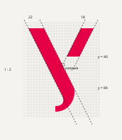

# Логотип УрФУ — обновление «Точная У»

Файлы собираются скриптом [tools/build-logo.mjs](../../tools/build-logo.mjs): `cd tools && npm run logo`. Надписи переведены в кривые из Golos Text, поэтому SVG не зависят от установленных шрифтов.

## Что изменилось и почему

| Было | Стало |
|---|---|
| Знак отрисован неравномерно, на сайте растровый | Знак собран из трёх простых форм на модульной сетке, только вектор |
| «Галочка» есть только в отдельном знаке, в лок-апе её нет | «Галочка» — постоянная часть знака: «У» читается во всех версиях |
| Красный знака `#E50046` отсутствует в палитре брендбука | `#E50046` становится главным акцентным цветом системы |
| Нет версии для фавикона и иконки приложения | Есть `favicon.svg` (32) и `app-icon.svg` (512) |
| Надпись набрана уникальным, но плохо масштабируемым шрифтом | Надпись набрана Golos Text SemiBold — тем же шрифтом, что и интерфейс |

Сохранено главное из брендбука 2025 года: буква «У» с прерванной линией, которую глаз дорисовывает сам, красный знак при графитовом тексте, трёхстрочный верхний блок, нижний блок с именем Б.Н. Ельцина.

## Построение

- Знак — 92 × 118 единиц. Оба штриха идут под **наклоном 1:2 (26,57° от вертикали)**. Этот же угол используется в интерфейсе для диагоналей: логотип и сайт говорят на одном языке.
- Основной штрих — 22 единицы по горизонтали, плоский срез сверху; внизу он переходит в каллиграфический хвост с вертикальным срезом.
- «Галочка» — 18 единиц (оптически легче основного штриха), обрывается на y = 40. Без разрыва она встретила бы основной штрих в точке (48; 52): этот разрыв и есть «прерванная линия».
- Верхний блок: три строки, от верха прописной первой строки до базовой линии третьей — ровно высота знака. Кегль ≈ 40,7 единицы, шаг строк 1,1 кегля.
- Отступ знак → текст — половина кегля (≈ 20 единиц).
- Нижний блок: 0,4 кегля верхнего, Regular, отступ сверху — x-высота верхнего блока.
- В аббревиатуре знак работает первой буквой: знак + «рФУ» читается как «УрФУ» (не «У + УрФУ»). Прописные «Ф» и «У» равны основному штриху знака (0…84), хвост знака опускается как нижний выносной элемент, зазор — обычная межбуквенная разрядка от верхней точки «галочки».

Точные числа — в [metrics.json](metrics.json).

## Версии

| Файл | Когда использовать |
|---|---|
| `urfu-full-ru-*` | официальные документы, первая страница сайта в футере, вывески |
| `urfu-short-ru-*` | основная версия: шапка сайта на десктопе, презентации, мерч |
| `urfu-short-en-*` | англоязычная версия сайта и материалы |
| `urfu-abbr-*` | шапка сайта на мобильном, соцсети, маленькие форматы |
| `urfu-sign-*` | аватары, паттерны, анимация, знаки институтов |
| `favicon.svg`, `app-icon*.svg` | вкладка браузера, иконка приложения «УрФУ.Учёба» |

Цвет: `-color` (красный знак + графит) на светлых фонах, `-white` на графите, синем и красном, `-ink` для одноцветной печати.

## Правила

- **Охранное поле** — две x-высоты верхнего блока (≈ 43 единицы при высоте знака 118), то есть примерно 0,36 высоты знака со всех сторон.
- **Минимальный размер:** короткая версия — 100 px (25 мм) по ширине, аббревиатура — 56 px, знак — 16 px (фавикон).
- **Фоны:** бетон `#E8E7E2`, белый, бумага `#F4F3EF` — цветная версия; графит `#1D1D1B`, синий `#174496`, красный `#E50046` — белая версия. На фото — только белая версия на затемнённом участке.
- **Нельзя:** менять пропорции и наклон, убирать «галочку», перекрашивать знак в другие цвета, кроме перечисленных, ставить цветную версию на красный фон, добавлять тени и обводки, поворачивать.
- **Институты:** знак остаётся красным, название института набирается Golos Text SemiBold отдельной строкой под верхним блоком на расстоянии x-высоты. «Галочку» можно перекрасить в цвет направления только в знаках подразделений, не в основном логотипе.
