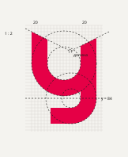

# Логотип УрФУ — знак «У-долина»

Файлы собираются скриптом [tools/build-logo.mjs](../../tools/build-logo.mjs): `cd tools && npm run logo`. Надписи переведены в кривые из Golos Text, поэтому SVG не зависят от установленных шрифтов.

## Идея

Знак — латинская **U** (Ural, University), у которой правая ножка уходит вниз и загибается крючком: получается рукописная кириллическая **«у»**. Верх обеих ножек срезан к центру под наклоном 1:2 — два склона и долина между ними, **Урал**. Этот же угол режет диагонали и плашки интерфейса, так что знак и сайт говорят на одном языке.

Знак выбран по отзывам студентов: прежняя «Точная У» с отдельной «галочкой» не понравилась, вариант «U с крючком» предложили сами студенты, срезы-склоны добавили связь с Уралом. Варианты, которые сравнивали: [sign-options.png](sign-options.png).

| Было | Стало |
|---|---|
| Знак отрисован неравномерно, на сайте растровый | Один векторный контур на модульной сетке: прямые, две дуги и срезы 1:2 |
| «Галочка» есть только в отдельном знаке, в лок-апе её нет | Знак цельный и одинаковый во всех версиях — от вывески до фавикона 16 px |
| Красный знака `#E50046` отсутствует в палитре брендбука | Красный закреплён только за знаком, интерфейс ведёт фирменный синий `#174496` (Pantone 293 C) — как в брендбуке 2025 |
| Нет версии для фавикона и иконки приложения | Есть `favicon.svg` (32) и `app-icon.svg` (512) |
| Надпись набрана уникальным, но плохо масштабируемым шрифтом | Надпись набрана Golos Text SemiBold — тем же шрифтом, что и интерфейс |

Сохранено из брендбука 2025 года: буква «У» как знак, красный знак при графитовом тексте, трёхстрочный верхний блок, нижний блок с именем Б.Н. Ельцина.

## Построение

- Знак — 82 × 118 единиц. Ножки — 20 единиц. Чаша «U» — дуги радиусами 21 и 41 с центром (41; 40), её низ на y = 81 ≈ высота прописной 84.
- Правая ножка продолжается вниз и переходит в крючок: дуги радиусами 12 и 32 с центром (50; 84), вертикальный срез на x = 24. Крючок — нижний выносной элемент, до y = 118.
- Верх ножек срезан к центру под **наклоном 1:2**: левая от (0; 0) до (20; 10), правая на 8 единиц ниже — профиль хребта. Продолжения срезов сходятся в точке (49; 24,5) над чашей — «долина».
- Верхний блок: три строки, от верха прописной первой строки до базовой линии третьей — ровно высота знака. Кегль ≈ 40,7 единицы, шаг строк 1,1 кегля.
- Отступ знак → текст — половина кегля (≈ 20 единиц).
- Нижний блок: 0,4 кегля верхнего, Regular, отступ сверху — x-высота верхнего блока.
- В аббревиатуре знак работает первой буквой: знак + «рФУ» читается как «УрФУ». Прописные «Ф» и «У» равны высоте чаши (0…84), крючок опускается как нижний выносной элемент.
- В анимации знак делится на две части: «U» и правый склон с крючком, который въезжает по наклону 1:2 (обложка главной, загрузка).

Точные числа — в [metrics.json](metrics.json).

## Версии

| Файл | Когда использовать |
|---|---|
| `urfu-full-ru-*` | официальные документы, первая страница сайта в футере, вывески |
| `urfu-short-ru-*` | основная версия: презентации, мерч, документы |
| `urfu-short-en-*` | англоязычная версия сайта и материалы |
| `urfu-abbr-*` | шапка сайта (знак — первая буква «УрФУ»; полное название стоит на обложке главной и в футере), соцсети, маленькие форматы |
| `urfu-sign-*` | аватары, паттерны, анимация, знаки институтов |
| `favicon.svg`, `app-icon*.svg` | вкладка браузера, иконка приложения «УрФУ.Учёба» |

Цвет: `-color` (красный знак + графит) на светлых фонах, `-dark` (красный знак + белый текст, «полноцветное на тёмном» из брендбука) на графите и в тёмной теме сайта, `-white` на синем, на фото и на красном, `-ink` для одноцветной печати.

## Правила

- **Охранное поле** — две x-высоты верхнего блока (≈ 43 единицы при высоте знака 118), то есть примерно 0,36 высоты знака со всех сторон.
- **Минимальный размер:** короткая версия — 100 px (25 мм) по ширине, аббревиатура — 56 px, знак — 16 px (фавикон).
- **Фоны:** бетон `#E8E7E2`, белый, бумага `#F4F3EF` — цветная версия; графит `#1D1D1B`, синий `#174496`, красный `#E50046` — белая версия. На фото — только белая версия на затемнённом участке.
- **Нельзя:** менять пропорции и наклон срезов, отделять крючок от «U», перекрашивать знак в другие цвета, кроме перечисленных, ставить цветную версию на красный фон, добавлять тени и обводки, поворачивать.
- **Институты:** знак остаётся красным, название института набирается Golos Text SemiBold отдельной строкой под верхним блоком на расстоянии x-высоты. Крючок можно перекрасить в цвет направления только в знаках подразделений, не в основном логотипе.
